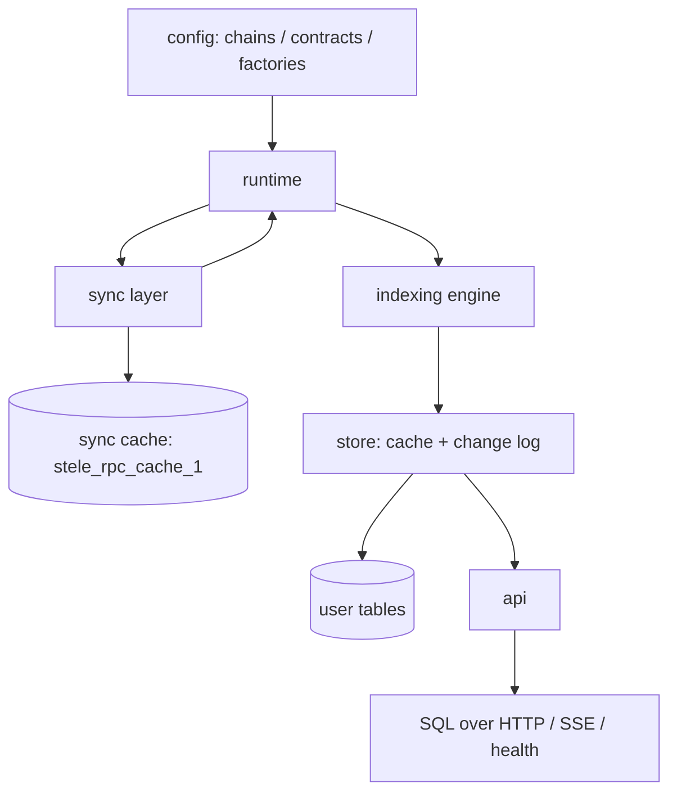

# 架构

## 1. 分层



四层职责：

| 层 | 职责 | 不负责 |
|---|---|---|
| config | 校验链、合约、ABI、起始块、工厂关系，生成 filter 与 fragment | 任何网络与数据库访问 |
| sync | 从 RPC 拉区块、日志、交易、回执、trace，按区间缓存，处理 reorg 后的缓存失效 | 解码业务事件、调用用户代码 |
| runtime | 计算缺哪些区间、需要哪些地址、事件按 checkpoint 排序，驱动 backfill 与 live | 具体表的读写语义 |
| indexing engine | 调用处理函数，提供 Context，管理缓存、事务、错误与回滚 | RPC 区块范围计算 |

## 2. 数据流

backfill：

```text
config -> fragments -> 计算缺失区间
  -> sync 拉取并写入 cache 表
  -> runtime 展开成事件流（按 checkpoint 排序）
  -> engine 调用 handler
  -> store 写内存缓存
  -> 每个 checkpoint 批量 flush 到 Postgres
```

live：

```text
轮询 head / 订阅区块 -> 判断是否达到 finality 水位
  -> 拉取 finality 到 head 的增量
  -> 写入 cache -> 检测父哈希不匹配 -> 触发 revert
  -> 事件流继续交给同一套 engine
```

backfill 与 live 使用同一套 handler 和排序规则，只有 RPC 拉取方式与并发度不同。用户代码不需要知道当前处于哪种模式。

## 3. 概念映射

| 概念 | 实现 | 说明 |
|---|---|---|
| 配置 | `SteleConfig` + `#[stele::contract]` 宏 | 编译期与运行期两种注册方式，见 `03-config-and-schema.md` |
| 表定义 | `#[derive(OnchainTable)]` | 列类型、主键、索引、视图、关系 |
| 事件注册 | `indexer.on::<Contract, Event>(fn)` | 事件类型来自 `sol!` 生成的结构体 |
| 事件参数 | `event.args: 事件结构体` | 强类型 decode，失败即错误 |
| 用户表读写 | `ctx.db` | 写操作进缓存 |
| 只读链调用 | `ctx.client` | alloy Provider，带缓存 |
| 合约调用 | `ctx.contracts` | 类型化合约调用 |
| RPC 缓存 | `stele_rpc_cache_1` | 9 张缓存表，可随时清空重建 |
| reorg 窗口 | `reorg_window` | 超出窗口的 reorg 直接报错，不静默修复 |
| checkpoint | `Checkpoint` newtype | 75 位定长，字典序即时间序 |
| 查询 | SQL over HTTP、SSE；GraphQL 后置 | 安全校验与资源限制 |

## 4. 系统不变量

实施时必须保持以下五条，测试逐条覆盖。

1. 同一链的事件按 checkpoint 严格递增处理。链内不允许并发调用 handler；跨链顺序由 checkpoint 的 `blockTimestamp` 与 `chainId` 决定。
2. 写入先进入内存缓存，flush 以 checkpoint 为原子单位。一个 checkpoint 产生的所有表变更要么全部落库，要么全部丢弃；handler 抛错时该 checkpoint 的事务不提交。
3. reorg 只在 `reorg_window` 内自动修复。超出窗口说明数据已经越过 finalized 语义，框架报错并停止推进，不带着分叉数据继续。
4. 回滚依赖数据库中的变更日志，不依赖 handler 的逆操作。任何写入路径（含 raw SQL）都要被记录，否则回滚不完整。
5. 同步缓存与用户表分开命名空间。`stele_rpc_cache_1` 下的数据可以随时清空重建，用户表不可以；`db reset` 必须显式确认。

## 5. 进程模型

| 模式 | 进程 | 用途 |
|---|---|---|
| `stele start` | 同步 + 索引 + API | 生产默认，单进程，单实例 |
| `stele serve` | 只读 API | 与索引进程共用数据库，横向扩展读 |
| `stele dev` | 监督进程 + 子进程 | 本地开发，文件变化时重启子进程并按策略重建表 |

索引进程有状态：同一数据库同一配置只允许一个写实例。多副本需要外部选主（`pg_advisory_lock` 或部署层单实例），框架不内置分布式协调。
